 

## 💡 About Me

I'm a Computer Engineering graduate from **Toronto Metropolitan University** who builds computer-vision and machine-learning systems that run in real time on real devices.

I care as much about measuring how well something works as I do about getting it to work.

 

## 🛠️ Featured Builds

<table>
<tr>
<td width="50%" valign="top">

### 🏀 Basketball Shot Tracker

*Calls every shot made or missed, live on an iPhone.*

- Finds and calls **85.6%** of shots correctly in a gym it had never seen
- Runs **live at ~30 fps** on an iPhone 11 (YOLOv8 → Core ML)
- Physics-based shot judge: arc fitting, rim crossing, rim rattles
- **110 tests** on every push through GitHub Actions

</td>
<td width="50%" valign="top">

### 😴 Driver Drowsiness Detection

*Sounds an alarm when a driver starts nodding off.*

- **99.2%** eye-state and **96.2%** yawn accuracy (MobileNetV2 on TFLite)
- **16,000-image** dataset built with our own MediaPipe labelling tool
- Fuses eye closure, yawns and head tilt into one alert score
- Capstone project with a team of four

</td>
</tr>
</table>

 

## 🧰 Toolbox

<table>
<tr>
<td><b>Languages</b></td>
<td></td>
</tr>
<tr>
<td><b>ML & Vision</b></td>
<td>
 

</td>
</tr>
<tr>
<td><b>On-device</b></td>
<td>

</td>
</tr>
<tr>
<td><b>Hardware</b></td>
<td>

</td>
</tr>
<tr>
<td><b>Tools</b></td>
<td></td>
</tr>
</table>

 

## 📈 GitHub Activity

 

## 🤝 Let's Connect

I'm looking for **2026/2027 internships** and **entry-level roles** in machine learning, computer vision, software engineering or embedded systems.

Feel free to reach out anytime.

 

